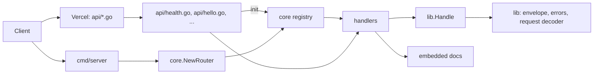

# Architecture

The project has two entrypoints over the same handlers: one function per file on Vercel, and one `net/http` server everywhere else.



## Layers

| Layer | Files | Responsibility |
|---|---|---|
| Functions | `api/*.go` | One exported `http.HandlerFunc` per file, an `init` registration, and an unexported function with the real logic |
| Handler adapter | `lib/handler.go` | `Handle` applies the method guard, recovers panics, wraps success, and maps errors |
| Request | `lib/request.go` | `DecodeJSON` with a size cap and strict decoding, plus `Query` and `RequiredQuery` |
| Response | `lib/response.go` | `Respond`, `OK`, `Created`, `NoContent`, and the single JSON writer |
| Errors | `lib/error.go` | `APIError`, stable error codes, constructors, and `WriteError` |
| Registry | `core/router.go` | Collects registrations, builds the local mux, and owns dispatch 404/405 |
| Local server | `cmd/server/main.go` | Blank-imports `api`, reads `PORT`, starts `net/http` |
| Docs | `docs/` | OpenAPI spec, Swagger UI page, embedded files |

Vercel's zero-config Go builder maps the file name to the URL. `api/health.go` becomes `/api/health`; `api/openapi.yaml.go` becomes `/api/openapi.yaml`. No rewrite and no route configuration are involved.

## Decisions

Standard library only. Go 1.22 added method and path patterns to `ServeMux`, which covers everything the local server needs. A router dependency would add a supply chain and a second API for no gain. `lib/` uses only `net/http`, `encoding/json`, and the rest of the standard library.

Per-file functions on Vercel. `vercel.json` sets `"framework": null`, so Vercel does not select the Go server preset. Instead it treats every `.go` file in `api/` as its own function. Adding an endpoint means adding a file and redeploying.

Registry for local parity. Every endpoint file calls `core.Register` from `init`. `cmd/server` blank-imports `api`, which runs those `init` functions, and `NewRouter` builds the mux from the result. Registration happens at startup, not while the server is running, and a duplicate method and path panics immediately. This is the closest Go equivalent to Vercel's file discovery without code generation.

Package name `handler`. Vercel rejects `package main` when `go.mod` is present, so every file in `api/` declares `package handler`. All files compile as one package locally, which means exported handler names must be unique across the directory. Only one exported handler per file is safe because Vercel picks the first exported function with the `http.HandlerFunc` signature.

One handler shape. The exported handler is a thin adapter:

```go
func Items(w http.ResponseWriter, r *http.Request) {
	lib.Handle(w, r, items, http.MethodGet, http.MethodHead)
}

func items(r *http.Request) (any, error) { ... }
```

The logic function never touches `http.ResponseWriter`. It returns the value for the success envelope or an error. `lib.Handle` enforces the method, recovers a panic, maps the error, and writes the envelope. Because the exported function itself calls `Handle`, the behavior is identical on Vercel and on `cmd/server`; neither host has to add middleware.

The HTTP contract lives in `lib/`. `core/` owns registration, routing, and logging, while `lib/` owns the wire format: request decoding, the success envelope, error codes, and the handler adapter. Keeping them apart means a change to the response shape does not touch the registry, and a change to routing does not touch handlers. Both packages are normal packages outside `internal/`.

Envelope. Every 2xx JSON response is `{"data": ...}`. Every failure is `{"error": {"code": ..., "message": ...}}`. Stable codes live in `lib/error.go`, so clients can branch on `code` without parsing prose. A handler returns `lib.BadRequest`, `lib.NotFound`, and the other constructors when it wants a specific status; any other error becomes a generic 500. The cause is logged and never returned.

Strict requests. `lib.DecodeJSON` reads at most the configured limit plus one byte, rejects a body over the limit with 413, rejects unknown fields and trailing values, and rejects an empty body. Query helpers return the same `*APIError` type, so request validation cannot invent a new status or code.

Shared code lives outside `internal/`. During the function build, Vercel rewrites the module to `handler`. An import of `haqi/go-serverless/internal/...` then crosses the `internal` boundary and fails. `core/` and `lib/` are normal packages, so they stay importable.

API prefix. The directory provides the prefix. `api/hello.go` is `/api/hello`, so routes cannot drift away from the file layout.

Handlers guard methods. A Vercel function receives every method sent to its URL, so `lib.Handle` checks the method before running the logic. `cmd/server` also answers 405 before dispatch, built from the same registry. Both paths return the same `Allow` header and JSON body. The raw docs handlers call `lib.Allow` directly because they do not use the JSON envelope.

Spec first. `docs/openapi.yaml` is written by hand and served by the app. The Swagger UI page loads a pinned `swagger-ui-dist` from jsDelivr. No generator means no build step and no generated files to review.

Logging. `core/logging.go` configures `slog` JSON output once, when the package is imported. Every function and `cmd/server` get the same configuration. `lib.WriteError` logs every 5xx with the method, path, code, and cause.

## Documentation page

`/api/docs` is stock Swagger UI with no custom layout and no motion. Its job is to exercise the API, not to market it, so the design dials are ENERGY 1 / RHYTHM 1 / MOTION 1. The only customization is the page title, the spec URL, and two color rules that darken the version badges to meet WCAG AA contrast.

## Failure behavior

JSON endpoints share one failure path through `lib.Handle`:

| Condition | Status | Code |
|---|---|---|
| Invalid query or body | 400 | `invalid_request` |
| Wrong method | 405 plus `Allow` | `method_not_allowed` |
| Body over the limit | 413 | `payload_too_large` |
| Any other error or a panic | 500 | `internal_error` |

The 500 message is always `internal server error`; the cause is logged as JSON. A panic is recovered per request, so one failed request does not take down the local server or skip the response on a function.

The two docs handlers write raw HTML and YAML, so they keep their own writes and use only `lib.Allow`. A panic there is not recovered and surfaces through the host.

Unknown paths differ by host. `cmd/server` has a catch-all and returns the JSON 404 shape for `/` and `/api`. On Vercel, no function matches an unknown path, so the platform's HTML 404 is returned before any Go code runs.

## Host behavior

The handlers read only the request method, path, query string, and body. They do not inspect host headers, so a query string reaches the handler unchanged on every platform. `cmd/server` binds `:PORT`, which Docker and the recipes in [portability.md](portability.md) expect. Vercel functions do not bind a port at all.
