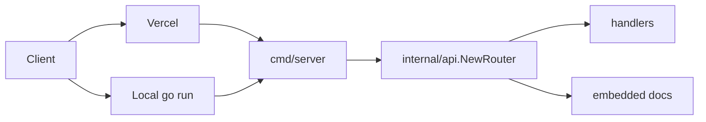

# Architecture

The project is a portable `http.Handler` reached through one entrypoint, `cmd/server`.

## Layers

| Layer | Files | Responsibility |
|---|---|---|
| Entrypoint | `cmd/server/main.go` | Read `PORT`, start `net/http` |
| Router | `internal/api/router.go` | Methods, paths, 404 and 405 responses |
| Handlers | `internal/api/handlers.go` | Request parsing, validation, JSON responses |
| Docs | `docs/` | OpenAPI spec, Swagger UI page, embedded files |

Vercel builds `cmd/server` directly. There is no host adapter to keep in sync.

## Decisions

Standard library only. Go 1.22 added method and path patterns to `ServeMux`, which covers everything these routes need. A router dependency would add a supply chain and a second API for no gain.

Server mode on Vercel. The Go framework preset builds `cmd/server` and runs it on `PORT`. A per-file `/api` function needs a rewrite that replaces the original path with `/api`, which then needs a host-specific path transform to recover. Running the server keeps paths native and matches every other host in this repository.

Spec first. `docs/openapi.yaml` is written by hand and served by the app. The Swagger UI page loads a pinned `swagger-ui-dist` from jsDelivr. No generator means no build step and no generated files to review.

Logging. `internal/api/logging.go` configures `slog` JSON output once, when the package is imported. `cmd/server` is the only entrypoint, so one configuration covers every host.

## Documentation page

`/docs` is stock Swagger UI with no custom layout and no motion. Its job is to exercise the API, not to market it, so the design dials are ENERGY 1 / RHYTHM 1 / MOTION 1. The only customization is the page title, the spec URL, and two color rules that darken the version badges to meet WCAG AA contrast.

## Failure behavior

Handlers return the shared error shape for bad input. Unknown paths return JSON 404, including `/`. Wrong methods return 405 with an `Allow` header, implemented with bare path patterns because a catch-all `/` would otherwise swallow those requests into 404. `GET` routes also answer `HEAD`. The OpenAPI document lists 400, 405, and 413 where they apply. Unexpected failures surface through the platform; there is no panic recovery middleware in this boilerplate.

## Host behavior

The router reads only the request method, path, query string, and body. It does not inspect host headers, so a query string reaches the handler unchanged on every platform. `cmd/server` binds `:PORT`, which is what Vercel, Docker, and the other recipes in [portability.md](portability.md) expect.
