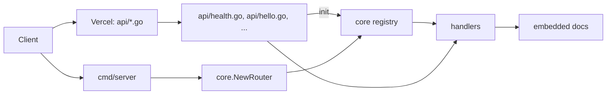

# Architecture

The project has two entrypoints over the same handlers: one function per file on Vercel, and one `net/http` server everywhere else.

## Layers

| Layer | Files | Responsibility |
|---|---|---|
| Functions | `api/*.go` | One exported `http.HandlerFunc` per file, plus an `init` registration |
| Registry | `core/router.go` | Collects registrations and builds the local mux |
| Helpers | `core/response.go` | `WriteJSON`, `WriteError`, and the `Allow` method guard |
| Local server | `cmd/server/main.go` | Blank-imports `api`, reads `PORT`, starts `net/http` |
| Docs | `docs/` | OpenAPI spec, Swagger UI page, embedded files |

Vercel's zero-config Go builder maps the file name to the URL. `api/health.go` becomes `/api/health`; `api/openapi.yaml.go` becomes `/api/openapi.yaml`. No rewrite and no route configuration are involved.

## Decisions

Standard library only. Go 1.22 added method and path patterns to `ServeMux`, which covers everything the local server needs. A router dependency would add a supply chain and a second API for no gain.

Per-file functions on Vercel. `vercel.json` sets `"framework": null`, so Vercel does not select the Go server preset. Instead it treats every `.go` file in `api/` as its own function. Adding an endpoint means adding a file and redeploying.

Registry for local parity. Every endpoint file calls `core.Register` from `init`. `cmd/server` blank-imports `api`, which runs those `init` functions, and `NewRouter` builds the mux from the result. Registration happens at startup, not while the server is running, and a duplicate method and path panics immediately. This is the closest Go equivalent to Vercel's file discovery without code generation.

Package name `handler`. Vercel rejects `package main` when `go.mod` is present, so every file in `api/` declares `package handler`. All files compile as one package locally, which means exported handler names must be unique across the directory. Only one exported handler per file is safe because Vercel picks the first exported function with the `http.HandlerFunc` signature.

Shared code lives outside `internal/`. During the function build, Vercel rewrites the module to `handler`. An import of `haqi/go-serverless/internal/...` then crosses the `internal` boundary and fails. `core/` is a normal package, so it stays importable.

API prefix. The directory provides the prefix. `api/hello.go` is `/api/hello`, so routes cannot drift away from the file layout.

Handlers guard methods. A Vercel function receives every method sent to its URL, so each handler calls `core.Allow` first. `cmd/server` also answers 405 before dispatch, built from the same registry. Both paths return the same `Allow` header and JSON body.

Spec first. `docs/openapi.yaml` is written by hand and served by the app. The Swagger UI page loads a pinned `swagger-ui-dist` from jsDelivr. No generator means no build step and no generated files to review.

Logging. `core/logging.go` configures `slog` JSON output once, when the package is imported. Every function and `cmd/server` get the same configuration.

## Documentation page

`/api/docs` is stock Swagger UI with no custom layout and no motion. Its job is to exercise the API, not to market it, so the design dials are ENERGY 1 / RHYTHM 1 / MOTION 1. The only customization is the page title, the spec URL, and two color rules that darken the version badges to meet WCAG AA contrast.

## Failure behavior

Handlers return the shared error shape for bad input. Wrong methods return 405 with an `Allow` header from `core.Allow`, and the local router applies the same rule before dispatch. `GET` routes also answer `HEAD`. The OpenAPI document lists 400, 405, and 413 where they apply.

Unknown paths differ by host. `cmd/server` has a catch-all and returns the JSON 404 shape for `/` and `/api`. On Vercel, no function matches an unknown path, so the platform's HTML 404 is returned before any Go code runs. Unexpected failures surface through the platform; there is no panic recovery middleware in this boilerplate.

## Host behavior

The handlers read only the request method, path, query string, and body. They do not inspect host headers, so a query string reaches the handler unchanged on every platform. `cmd/server` binds `:PORT`, which Docker and the recipes in [portability.md](portability.md) expect. Vercel functions do not bind a port at all.
