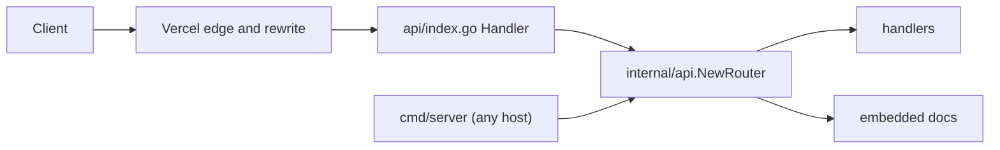

# Architecture

The project is a portable `http.Handler` with two thin entrypoints.

## Layers

| Layer | Files | Responsibility |
|---|---|---|
| Adapters | `api/index.go`, `cmd/server/main.go` | Translate a host's entrypoint into a call to the router |
| Router | `internal/api/router.go` | Methods, paths, 404 and 405 responses |
| Handlers | `internal/api/handlers.go` | Request parsing, validation, JSON responses |
| Docs | `docs/` | OpenAPI spec, Swagger UI page, embedded files |

Adapters contain no route logic. Both call `api.NewRouter()`, so a route added in one place appears on every host.

## Decisions

Standard library only. Go 1.22 added method and path patterns to `ServeMux`, which covers everything these routes need. A router dependency would add a supply chain and a second API for no gain.

One Vercel Function. `api/index.go` serves every route behind a rewrite. This keeps the handler portable and gives one cold start path. Vercel turns each Go file in `api/` into a separate function, so shared code lives in `internal/`, never beside the adapter.

Spec first. `docs/openapi.yaml` is written by hand and served by the app. The Swagger UI page loads a pinned `swagger-ui-dist` from jsDelivr. No generator means no build step and no generated files to review.

Logging. `internal/api/logging.go` configures `slog` JSON output once, when the package is imported. That covers `cmd/server` and the function adapter, which has no `main`.

## Documentation page

`/docs` is stock Swagger UI with no custom layout and no motion. Its job is to exercise the API, not to market it, so the design dials are ENERGY 1 / RHYTHM 1 / MOTION 1. The only customization is the page title, the spec URL, and two color rules that darken the version badges to meet WCAG AA contrast.

## Path handling on Vercel

The rewrite in `vercel.json` sends every request to `/api`. Depending on how Vercel forwards the request, the function can see either the original path (`/health`) or the rewritten one (`/api/health`). `api/index.go` strips a leading `/api` before calling the router, so both forms work.

This is the one host-specific detail in the code. It lives in the adapter, and the fallback is documented in the README: switch to Go server mode and delete `api/`.

## Failure behavior

Handlers return the shared error shape for bad input. Unknown paths return JSON 404. Wrong methods return 405 with an `Allow` header, implemented with bare path patterns because a catch-all `/` would otherwise swallow those requests into 404. Unexpected failures surface through the platform; there is no panic recovery middleware in this boilerplate.
